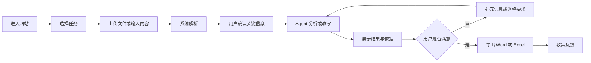
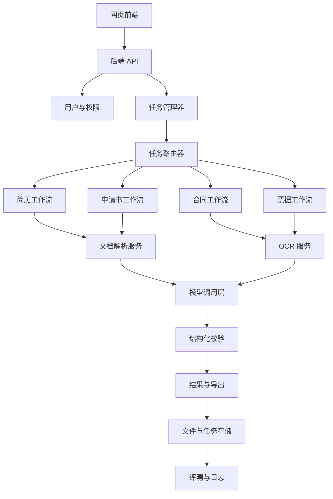
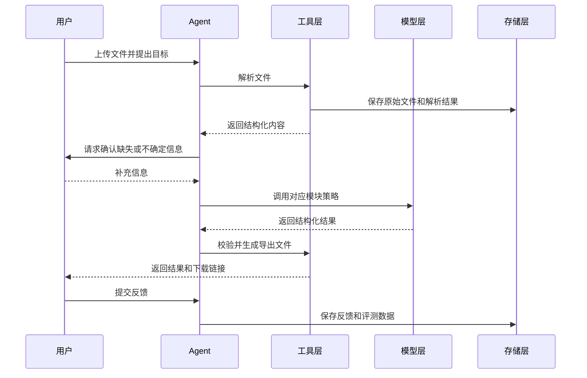

# 青年文书智能助手项目流程

> 版本：v0.2
>
> 日期：2026-10-05
>
> 项目阶段：工程 MVP 已完成，真实样本验收进行中，决策门 C 尚未通过
>
> 目标：先做出一个可用的智能助手，再根据真实使用数据考虑商业化。

## 1. 项目概述

### 1.1 项目定位

面向正在求职、实习或初入职场的青年，提供关键文书处理服务：

`上传文档 -> 识别内容 -> 分析问题 -> 生成结果 -> 用户确认 -> 导出文件`

项目不试图一次性解决所有文书问题，而是围绕青年的阶段性需求逐步扩展。

### 1.2 目标用户

| 用户类型 | 典型场景 | 主要需求 |
| --- | --- | --- |
| 在校学生 | 实习申请、助学金申请、活动申请 | 表达规范、内容完整、格式正确 |
| 应届毕业生 | 求职、面试、签约 | 简历匹配岗位、识别合同风险 |
| 实习生 | 入职、报销、日常申请 | 降低文档处理成本、快速完成报销 |
| 初入职场青年 | 租房、兼职、离职、请假 | 看懂合同、规范书面表达 |

### 1.3 核心价值

- 降低文书处理门槛。
- 将复杂文档转成通俗、可执行的结果。
- 减少遗漏、格式错误和常见风险。
- 把重复工作交给 Agent，把最终判断权留给用户。

### 1.4 第一版不做的事情

- 不提供正式法律意见。
- 不替用户编造简历、经历或申请事实。
- 不自动替用户签署、提交或对外发送文件。
- 不承诺岗位匹配结果、录取结果或报销结果。
- 不在 MVP 阶段同时开发四个完整模块。

### 1.5 当前落地状态

截至 2026-10-04，仓库已经提供可运行的 Python 命令行 Agent 和本地 Web 工作台：

| 能力 | 当前实现 | 上线定位 |
| --- | --- | --- |
| 任务路由 | 根据文本和文件名识别简历、申请函、合同、票据 | 可用 |
| 简历优化 | 岗位关键词匹配、问题审计、改写候选、事实约束 | 首发测试 |
| 申请书函 | 称呼、结尾、长句和口语表达检查，保留事实润色 | 首发测试 |
| 合同审阅 | 押金、续约、违约金、竞业、免责等规则识别 | 辅助测试，必须人工复核 |
| 票据整理 | 商家、日期、金额、类别提取，汇总和重复检测 | 辅助测试，必须核对原件 |
| 文档解析 | TXT、Markdown、JSON、CSV 原生支持；DOCX、PDF、图片按可选依赖启用 | 可用 |
| 模型接入 | 默认 Mock 本地规则；第三方在线服务适配器可选 | 本地模式已验证 |
| 输出 | Markdown 报告、JSON 结果；票据额外输出 CSV | 可用 |
| Web 工作台 | 任务选择、自动路由、文本粘贴、文件上传、示例载入、结果下载 | 本地单人可用 |
| 图片版 DOCX | 抽取内嵌图片并尝试 PaddleOCR；OCR 不可用时明确提示 | 本地可用，质量待真实样本验证 |
| 样本验收 | 证据分层、样本登记、人工基线、批量评测、JSON/Markdown 报告 | 公开回归可用，真实样本不足 |
| 工具与复现 | 软件、依赖、Skill、网站、GitHub 项目和发布包工具包 | 已建立 |
| 验证 | 42 项单元测试通过，12/12 离线评测和 20/20 公开回归通过 | 已验证 |

当前版本的价值是验证“任务路由 + 专用工作流 + 结构化结果 + 人工复核边界”是否成立，并提供一个无需 API Key 的本地 Web 验证入口。它还不是带登录、文件生命周期、云端存储、OCR 默认安装和正式法律意见能力的完整商业产品。Web 运行结果默认写入 `outputs/web/`。

### 1.6 当前进度总览

截至 2026-10-04，项目处在“工程 MVP 已完成，真实样本验收进行中”的位置。当前工作重点是收集并验证真实需求，而不是继续扩展功能。

| 阶段 | 状态 | 当前说明 |
| --- | --- | --- |
| 阶段 0：范围冻结 | 已完成 | 已确定四类青年文书任务、首发边界和明确的不做清单 |
| 阶段 1：用户与样本调研 | 进行中 | 已完成公开市场与 GitHub 调研；已建立 20 份公开许可与合成回归集，当前 20/20 通过。正式真实样本仍为 0/20；本机保留 1 份合成演示样本，另有 1 份非简历 DOCX 已隔离 |
| 阶段 2：PRD 与交互设计 | 部分完成 | 已有产品定义、视觉设计、Web 页面流程和接口草案；仍需用真实反馈修正 |
| 阶段 3：技术底座 | 本地 MVP 已完成 | 文档解析、任务路由、结果生成、下载和本地 Web 服务已打通；登录、云存储和持久化任务状态尚未建设 |
| 阶段 4：首个 Agent 工作流 | 已完成并扩展为四条 | 简历、申请书函、合同和票据工作流均可运行 |
| 阶段 5：评测和迭代 | 进行中 | 42 项单元测试、12/12 离线评测和 20/20 公开回归通过；公开回归不计入决策门 C，真实样本仍为 0/20，用户采纳数据仍缺失 |
| 阶段 6：隐私与安全 | 部分完成 | 公开演示已具备限流、短期结果清理、签名下载和日志路径收敛；登录、权限、加密和正式审计尚未实现 |
| 阶段 7：小范围内测 | 未开始 | 尚未邀请测试用户进行持续使用 |
| 阶段 8：上线和扩展 | 准备中 | 已通过临时 HTTPS 隧道完成公开演示复验；Docker 和 Compose 已在本机实跑并通过健康检查，Caddy 和正式云服务器部署尚未实跑；尚无账号、正式配额和运营流程 |
| 阶段 9：商业化评估 | 未开始 | 尚无付费信号、成本数据和重复使用证据 |

当前已经交付：

- v0.2 本地 Agent、命令行工具和 Web 工作台。
- 四类任务自动路由和四条专用工作流。
- Markdown、JSON、CSV 结果导出。
- 42 项单元测试、12/12 离线评测、20/20 公开回归和可安装 wheel。
- 图片版 DOCX 的内嵌图片抽取、PaddleOCR 回退和兼容性修复。
- 非 root Docker 镜像、Compose 持久卷、Caddy HTTPS 骨架和部署前检查脚本；本机容器已完成构建、启动和健康检查。
- 公网演示模式和后台上网隧道脚本；2026-10-04 已通过临时 HTTPS 入口完成合成样本复验。
- 证据分层的样本登记、人工基线、批量评测和报告流程。
- 独立工具包，已同步到 `D:\桌面\青年\opc-youth-toolkit`。
- GitHub 类似项目调研、市场 MVP 定义、产品设计和架构文档。

当前尚未证明：

- 20 至 50 份真实脱敏文档能否稳定处理。
- 真实用户是否认为结果有用并愿意再次使用。
- 第三方在线模型调用是否稳定、成本和延迟是否可接受。
- 合同风险结果是否达到可内测的准确率。
- 用户是否愿意为任何一项能力付费。

### 1.7 2026-10-02 进展快照

今天已经完成：

- 安装并验证 PaddleOCR 3.7.0、PaddlePaddle 3.3.1。
- 增加图片版 DOCX 的 OCR 回退，兼容 PaddleOCR 新旧结果格式，并规避 Windows 下 Paddle 3.3 oneDNN 图属性错误。
- 建立证据分层的样本清单、人工基线模板、批量评测报告和公开回归集。
- 收集并派生 20 份公开许可与项目合成回归样本，四类各 5 份。
- 为公开回归修复“实习申请信”和“活动经费申请书”的路由优先级问题。
- 重新运行测试：38/38 项单元测试通过，12/12 条离线评测通过，公开回归 20/20 通过。
- 复核图片版 DOCX：确认 `resume-002` 的 OCR 内容是编程题截图，不是简历，已从有效验收清单中隔离。
- 修正真实样本评测：报告新增自动路由验证覆盖，只有 `task=auto` 才计入路由通过率，显式指定任务不再伪装成路由通过。
- 运行本机演示样本评测：当前清单 1/1 行有效，自动评测 1/1 通过；真实样本仍为 0/20，决策门 C 未就绪。
- 建立并同步工具包，集中记录软件、Python 依赖、Skill、插件、网站、GitHub 项目、命令和发布包。
- 修正项目流程文档中“真实样本尚未开始”“20 项测试”和“当前目录还不是 Git 仓库”等过期描述。
- 安装并验证 Docker Desktop、Docker Engine 和 Compose，成功构建并启动本地容器。
- 通过临时公网 HTTPS 隧道完成合成申请函的提交、处理、报告生成和下载验收。

当前数字：

| 项目 | 当前值 |
| --- | ---: |
| 本机演示样本 | 1/20（项目合成） |
| 正式真实样本 | 0/20 |
| 公开回归有效样本 | public 15，synthetic 5，共 20 |
| 公开回归通过 | 20/20 |
| 公开回归路由验证 | 20/20 |
| 已隔离无效样本 | 1 |
| 单元测试 | 42/42 |
| 离线评测 | 12/12 |

说明：

- `resume-001` 是证据类型为 `synthetic` 的演示样本，自动路由通过，但不能替代真实用户验收。
- `resume-002` 的 OCR 文本显示为变量交换编程题截图，与简历无关；已从有效清单隔离，原始文件继续保留在 `samples/private/` 仅供排查，不再计入简历样本。
- 公开回归 20/20 只说明当前技术链路和规则回归通过，不代表任何真实样本质量结论。
- 只有报告中的 `evidence_type=real` 计入决策门 C；`public` 和 `synthetic` 不计入。
- 新的评测报告会单列“自动路由验证：N/总数”；显式指定 `task` 的记录显示为“未验证”，避免把绕开路由的运行算作路由通过。

下次继续时按以下顺序：

1. 提供并脱敏 20 份真实文档，按 `evidence_type=real` 登记，四类各 5 份。
2. 用 `task=auto` 登记或运行样本，同时验证解析和实际任务路由。
3. 邀请 5 至 10 名目标用户完成实际任务，记录完成率、事实编造率、风险识别准确率、导出率和再次使用意愿。
4. 修复高频失败，更新回归集和真实样本报告。
5. 决策门 C 通过前，不开始 v0.3、多 Agent、账号系统或商业化功能。

本地 Web 工作台启动方式：

```powershell
python -m opc_agent.web --port 8765
```

启动后访问 `http://127.0.0.1:8765/`。当前使用本地 `mock` 规则模式，不需要 API Key，服务仅监听本机。

下一阶段的完成标准：

1. 收集并脱敏至少 20 份真实文档，覆盖四类任务。
2. 邀请 5 至 10 名目标用户完成实际任务。
3. 记录完成率、事实编造率、风险识别准确率、导出率和再次使用意愿。
4. 修复真实样本暴露出的高频问题，并建立人工基线。
5. 根据数据决定优先强化哪个工作流，再讨论商业化和多 Agent 协作。

### 1.8 2026-10-04 公网演示优化

在不绕过决策门 C 的前提下，为公开演示补了一层安全边界：

- 新增 `OPC_PUBLIC_DEMO` / `--public-demo` 和 `OPC_PUBLIC_ALLOW_MODEL`，公网
  在线模型必须显式授权、配置 Key 并经用户确认；默认仍使用 `mock` 本地规则。
- PythonAnywhere 固定入口使用每 IP 每分钟 12 次、每日 6 次和全站每日 30 次额度，
  最多 2 个并发任务。
- PythonAnywhere 上传上限 15 MB、输入上限 20,000 字符、输出上限 1,600 tokens。
- 下载链接改为进程内 HMAC 签名，不再暴露可猜测的相对路径。
- 运行结果默认保留 1 小时后自动清理。
- 页面显示公开演示提示，要求只使用公开或合成样本。
- 新增限流、签名篡改、Provider 边界、过期清理和响应头相关测试。
- 新增 `Start-Public-Demo.ps1` 和 `Start-Public-Tunnel.ps1`，统一保存 PID、临时 URL 和日志。
- 通过 `localhost.run` 完成公网首页、健康接口、合成申请函提交、报告生成和签名下载复验。

当前回归数字更新为 42/42 项单元测试、12/12 条离线评测和 20/20 公开回归。公网演示
仍不得接收真实用户文档；本次临时地址随本机或 SSH 隧道关闭而失效。决策门 C、
正式内测和 v0.3 功能开发均未因此启动。

### 1.9 2026-10-05 页面可用性优化

在不改变“编辑校样桌”视觉语言和工作流的前提下，完成一轮页面打磨：

- 产品可见名称统一为“青年文书智能助手”，并补充 favicon 与主题色元数据。
- 移动端结果标题、置信度印章和元数据重排，避免信息拥挤和无效留白。
- 任务标签支持方向键、Home 和 End 键切换，并同步焦点与选中状态。
- 空输入错误聚焦正文输入框，服务端错误聚焦错误提示，缩短恢复路径。
- 结果区新增“修改文稿”返回入口，并改善滚动定位与滚动条对比度。
- 通过桌面、平板和手机五档视口复验，无横向溢出或元素重叠。
- 通过公网地址完成浏览器交互复验：控制台 0 错误，键盘切换、错误恢复、
  修改入口和两份下载链接均正常。

## 2. 用户旅程



用户旅程分为三个阶段：

1. 求职阶段：优化简历、生成申请材料。
2. 签约阶段：审阅合同、识别风险、生成修改提示。
3. 在岗阶段：识别票据、整理开销、导出报销表。

当前 MVP 已实现 Markdown、JSON 和票据 CSV 导出；流程图中的 Word、Excel 通用导出属于后续目标，不代表当前已经完成。

## 3. 产品模块

### 3.1 模块总览

| 模块 | 所属阶段 | 核心任务 | 主要输出 | 开发优先级 |
| --- | --- | --- | --- | --- |
| 简历优化 | 求职 | 提取经历、匹配岗位、优化表达 | 优化简历、匹配分析、面试建议 | P0 |
| 申请书函润色 | 求职与职场 | 规范语言和格式 | 润色后的申请信、辞职信、请假条 | P0 |
| 合同审阅 | 签约 | 识别权责与风险条款 | 通俗摘要、风险清单、修改提示 | P1 |
| 票据开销整理 | 在岗 | OCR 识别、分类、统计 | 收支表、报销清单、Excel 文件 | P2 |

### 3.2 模块一：简历优化

**输入**

- PDF、DOCX 简历
- 目标岗位描述
- 可选补充信息，例如项目成果、实习数据、求职方向

**处理流程**

1. 解析简历文件。
2. 提取个人资料、教育经历、项目经历、实习经历和技能。
3. 解析目标岗位要求。
4. 对经历与岗位要求进行匹配。
5. 查找表达模糊、缺少量化、重点不清的问题。
6. 在不改变事实的前提下重写。
7. 输出优化后正文和修改说明。

**输出**

- 结构化个人档案
- 岗位匹配分析
- 逐段修改建议
- 优化后的简历
- 面试准备问题
- DOCX 导出文件

**约束**

- 不编造学历、项目、数据或证书。
- 无法确认的信息必须标记为“待用户补充”。
- 匹配分数必须说明评分维度。

### 3.3 模块二：申请书函润色

**适用范围**

- 实习申请
- 求职信
- 助学金申请
- 活动申请
- 请假条
- 辞职信
- 其他个人书面材料

**处理流程**

1. 接收用户初稿。
2. 识别文书用途、对象和语气。
3. 检查结构、表达和格式。
4. 标记空泛、重复和不自然的内容。
5. 在保留事实的前提下润色。
6. 提供修改前与修改后的对照。

**约束**

- 不进行法律或财务风险审查。
- 不添加用户未提供的事实。
- 不替用户表达未经确认的承诺或立场。

### 3.4 模块三：合同审阅

**适用范围**

- 租房合同
- 兼职协议
- 实习协议
- 劳动合同
- 离职协议
- 其他青年常见协议

**处理流程**

1. 上传 PDF、Word 或合同照片。
2. OCR 和文档解析。
3. 按章节和条款切分文本。
4. 识别金额、期限、违约责任、解除条件、押金、竞业限制等要素。
5. 将风险分为低、中、高三级。
6. 用通俗语言解释条款。
7. 提供谈判或修改提示。
8. 引导用户对重大风险咨询律师或专业机构。

**输出**

- 合同基本信息表
- 权责摘要
- 风险条款清单
- 修改建议
- 需要向对方确认的问题

**边界**

- 明确声明结果仅用于辅助理解，不构成法律意见。
- 法律风险应尽量引用可核验依据，不能凭空生成法条。
- 涉及重大金额、人身权益、劳动权益时，必须提示人工复核。

### 3.5 模块四：票据开销整理

**输入**

- 发票照片
- 小票照片
- PDF 票据
- 多张票据组成的批次

**处理流程**

1. 图片预处理和 OCR。
2. 提取票据类型、商家、日期、金额、税额和报销类别。
3. 校验金额、日期和重复票据。
4. 对无法识别的字段进行人工确认。
5. 汇总统计。
6. 导出 Excel。

**输出**

- 票据明细表
- 分类汇总
- 异常和重复提示
- Excel 报销清单

**约束**

- 提取结果必须由用户确认。
- 金额计算采用程序计算，不只依赖模型文本输出。
- 不代替财务审核或税务处理。

## 4. 总体技术架构

### 4.1 架构原则

四个模块共享应用底座，但业务工作流相互独立。前期采用“任务路由 + 单一专用工作流”，不直接搭建复杂多 Agent 系统。

### 4.2 分层架构



### 4.3 共享能力

- 用户登录和权限控制
- 文件上传、存储和删除
- PDF、DOCX、图片解析
- OCR
- 模型调用和超时重试
- 任务状态管理
- 结构化输出校验
- Word 和 Excel 导出
- 执行日志、成本统计和评测

### 4.4 模块专属能力

| 模块 | 专属规则 | 专属工具 |
| --- | --- | --- |
| 简历优化 | 岗位匹配、经历提取、事实约束 | 简历解析、DOCX 导出 |
| 申请书函 | 文体、语气、格式、事实约束 | 文本对照、DOCX 导出 |
| 合同审阅 | 条款切分、风险分类、法律依据 | OCR、条款定位、风险规则库 |
| 票据整理 | 金额校验、分类统计、去重 | OCR、表格校验、Excel 导出 |

## 5. Agent 设计

### 5.1 Agent 角色

MVP 阶段只设一个主入口：

> 文档任务 Agent：判断任务类型，调用对应工作流，收集必要信息，生成可确认的结果。

### 5.2 运行步骤



### 5.3 Agent 必须具备的能力

- 任务分类
- 文件解析
- 缺失信息追问
- 模块工作流选择
- 结构化输出
- 事实一致性检查
- 风险等级判断
- 文件导出
- 错误恢复
- 结果来源说明

### 5.4 Agent 禁止行为

- 不确认事实就自动补全
- 把模型猜测当作确定结果
- 在无法识别时静默继续
- 将法律辅助结果包装成正式法律意见
- 未经用户确认自动对外提交文档

## 6. 数据对象

| 对象 | 说明 |
| --- | --- |
| User | 用户身份、偏好、授权记录 |
| File | 原始文件、类型、大小、解析状态 |
| Task | 任务类型、状态、输入、结果摘要 |
| Extraction | 从文档中提取的结构化字段 |
| Analysis | 风险、匹配度、改写建议等分析结果 |
| Artifact | 生成的 Word、Excel 或其他文件 |
| Feedback | 用户采纳、修改、评分和问题反馈 |
| Trace | 模型、工具、耗时、成本和错误记录 |

## 7. 核心接口草案

### 7.1 任务接口

当前 v0.2 已实现 `GET /api/health`、`GET /api/examples`、`POST /api/run` 和 `GET /api/download`。下表描述正式产品扩展时需要补齐的接口。

| 方法 | 路径 | 用途 |
| --- | --- | --- |
| POST | `/api/files` | 上传文件 |
| POST | `/api/tasks` | 创建处理任务 |
| GET | `/api/tasks/{id}` | 获取任务状态 |
| GET | `/api/tasks/{id}/result` | 获取分析结果 |
| POST | `/api/tasks/{id}/confirm` | 确认或补充信息 |
| POST | `/api/tasks/{id}/feedback` | 提交反馈 |
| GET | `/api/artifacts/{id}` | 下载导出文件 |

### 7.2 工具接口

| 工具 | 输入 | 输出 |
| --- | --- | --- |
| `parse_document` | PDF、DOCX、文本 | 段落、表格、结构化字段 |
| `ocr_image` | 图片、PDF 页面 | 文本、位置、置信度 |
| `extract_resume` | 简历文本 | 履历结构 |
| `match_job` | 履历结构、岗位描述 | 匹配项、缺口、分数依据 |
| `review_contract` | 合同条款 | 风险清单、等级、说明 |
| `polish_letter` | 初稿、用途、语气 | 对照文本、修改说明 |
| `extract_receipt` | 票据文本和图片 | 票据字段 |
| `validate_amounts` | 票据字段 | 金额校验结果 |
| `export_docx` | 结构化文档 | DOCX 文件 |
| `export_xlsx` | 表格数据 | Excel 文件 |

## 8. 项目实施阶段

### 阶段 0：范围冻结

**目标**

确定第一版只做什么，避免四个模块同时开工。

**任务**

- 确定首发用户。
- 确定首发模块。
- 确定输入和输出。
- 确定明确的不做清单。
- 确定评测方式。

**交付物**

- 一页项目定义
- MVP 范围表
- 成功标准

**通过条件**

- 能用一句话说明用户和问题。
- 能列出第一版不做的功能。

### 阶段 1：用户与样本调研

**目标**

确认用户真实需求和文档形态。

**任务**

- 访谈 5 到 10 名目标用户。
- 收集 20 到 50 份脱敏样本。
- 记录常见文件格式、长度和失败情况。
- 记录用户最关心的问题。

**交付物**

- 用户问题清单
- 脱敏样本集
- 样例输入输出

**通过条件**

- 至少 20 份可合法用于测试的样本。
- 能明确最高频的三个任务。

### 阶段 2：PRD 与交互设计

**目标**

把需求转成可开发的页面、接口和流程。

**任务**

- 编写 PRD。
- 设计上传、确认、结果和导出页面。
- 设计错误、超时和无法识别状态。
- 定义数据字段和接口。
- 定义隐私和删除流程。

**交付物**

- PRD
- 页面流程图
- API 草案
- 数据字典

**通过条件**

- 开发和设计对流程理解一致。
- 每个页面的输入、输出和异常状态明确。

### 阶段 3：技术底座

**目标**

打通文件从上传到结果导出的基础链路。

**任务**

- 建立前端和后端项目。
- 接入文件上传。
- 实现 PDF、DOCX 解析。
- 接入模型调用层。
- 建立任务状态和日志。
- 建立基础存储。

**交付物**

- 可运行的完整链路
- 测试环境
- 日志和错误监控

**通过条件**

- 上传一份测试简历后能获得结构化文本。
- 每一步失败都有可定位日志。

### 阶段 4：首个 Agent 工作流

**目标**

完成第一个可独立使用的工作流。建议先做“简历优化”，再把申请书函润色并入求职文书入口。

**任务**

- 定义结构化输出格式。
- 编写工作流提示词和规则。
- 实现缺失信息追问。
- 实现事实一致性检查。
- 生成优化文本和修改说明。
- 导出 DOCX。

**交付物**

- 简历优化工作流
- 申请书函润色工作流
- 示例结果

**通过条件**

- 至少完成 20 个真实任务的端到端测试。
- 不出现严重事实编造。
- 用户能理解并采纳主要建议。

### 阶段 5：评测和迭代

**目标**

用固定样本持续衡量 Agent 质量。

**任务**

- 建立评测集。
- 建立基线结果。
- 记录解析准确率。
- 记录事实一致性。
- 记录建议采纳率。
- 记录耗时和成本。
- 修复高频失败类型。

**交付物**

- 自动评测脚本或流程
- 评测报告
- 问题分类和迭代记录

**通过条件**

- 每轮改动都能和上一版比较。
- 核心错误类型有明确数量和趋势。

### 阶段 6：隐私与安全

**目标**

降低个人文件泄露和误用风险。

**任务**

- 明确隐私政策。
- 文件加密存储。
- 设置保存期限。
- 支持用户删除。
- 控制日志中的敏感信息。
- 设置访问权限。
- 明确模型数据使用规则。

**交付物**

- 隐私说明
- 数据生命周期
- 权限和删除方案

**通过条件**

- 用户能理解和控制自己的文件。
- 开发和运维人员不能无授权查看用户文件。

### 阶段 7：小范围内测

**目标**

验证真实用户是否愿意持续使用。

**任务**

- 邀请 20 到 50 名测试用户。
- 记录完成率、放弃点和反馈。
- 观察用户是否愿意导出和再次使用。
- 跟踪成本和响应时间。

**交付物**

- 内测报告
- Top 10 问题和改进清单

**通过条件**

- 多数用户能独立完成任务。
- 存在明确的复用需求。
- 核心问题不会阻塞流程。

### 阶段 8：上线和扩展

**目标**

在首个模块稳定后，逐步增加合同审阅和票据整理。

**任务**

- 发布 MVP。
- 接入用户账户和配额。
- 增加合同审阅工作流。
- 增加 OCR 和票据工作流。
- 建立反馈和客服流程。
- 建立版本和回滚机制。

**交付物**

- MVP 线上版本
- 模块扩展计划
- 运营和反馈流程

**通过条件**

- 首个模块的稳定性和用户留存达到预期。
- 新模块不会破坏已有流程。

### 阶段 9：商业化评估

**目标**

在数据和需求明确后再决定是否商业化。

**验证方向**

- 免费使用频率
- 重复使用率
- 导出和采纳率
- 单任务成本
- 用户愿意支付的场景
- 单次付费、订阅或机构合作的可行性

**商业化门槛**

- 至少一个模块具备稳定需求。
- 用户愿意为结果付费或组织愿意采购。
- 单任务成本低于可接受收入。
- 法律、隐私和交付责任边界清晰。

## 9. 研发目录建议

```text
opc-youth-document-agent/
├─ apps/
│  ├─ web/                 # 网页前端
│  └─ api/                 # 后端接口和任务调度
├─ agents/
│  ├─ router/              # 任务路由
│  ├─ resume/              # 简历工作流
│  ├─ letter/              # 申请书函工作流
│  ├─ contract/            # 合同工作流
│  └─ receipt/             # 票据工作流
├─ services/
│  ├─ parser/              # PDF、DOCX 解析
│  ├─ ocr/                 # 图片和扫描件识别
│  ├─ export/              # Word、Excel 导出
│  └─ storage/             # 文件和任务存储
├─ packages/
│  ├─ schemas/             # 数据结构和校验
│  └─ prompts/             # 版本化提示词
├─ evals/
│  ├─ datasets/            # 脱敏评测样本
│  ├─ expected/            # 预期结果
│  └─ reports/             # 评测报告
├─ docs/
│  ├─ prd/
│  ├─ architecture/
│  └─ privacy/
└─ tests/
```

## 10. 评测体系

### 10.1 通用指标

| 指标 | 说明 |
| --- | --- |
| 解析成功率 | 能否成功读取文件并提取正文 |
| 任务完成率 | 用户是否获得可用结果 |
| 事实一致性 | 是否出现原文没有的信息 |
| 结构化准确率 | 字段是否正确归类和抽取 |
| 用户采纳率 | 用户是否采用建议或导出结果 |
| 平均耗时 | 从上传到结果完成的耗时 |
| 单任务成本 | 模型、OCR、存储等综合成本 |
| 失败恢复率 | 错误后是否能重试或补充信息 |

### 10.2 模块专属指标

| 模块 | 重点指标 |
| --- | --- |
| 简历优化 | 经历提取准确率、岗位匹配解释性、事实编造率 |
| 申请书函 | 事实保持率、语气符合度、格式规范度 |
| 合同审阅 | 风险召回率、误报率、条款定位准确率 |
| 票据整理 | 字段识别准确率、金额正确率、重复票据识别率 |

### 10.3 评测流程

1. 选择固定脱敏样本。
2. 保存人工基线结果。
3. 每次修改后运行同一批样本。
4. 对比准确率、成本、耗时和失败类型。
5. 人工复核高风险输出。
6. 通过后再上线。

## 11. 风险与应对

| 风险 | 影响 | 应对 |
| --- | --- | --- |
| 同时开发四个模块 | 进度失控、质量不稳定 | 先做求职文书 MVP |
| 模型编造经历 | 用户求职风险 | 事实字段锁定、生成后校验 |
| 合同审查错误 | 法律和经济损失 | 风险分级、来源依据、人工复核提示 |
| OCR 识别错误 | 报销金额错误 | 程序校验、低置信度确认、重复检测 |
| 个人文件泄露 | 隐私和信任问题 | 加密、最小权限、删除机制 |
| 成本过高 | 无法持续运营 | 限制文件大小、缓存解析、记录单任务成本 |
| 用户不愿付费 | 无法商业化 | 先验证重复使用和真实付费意愿 |
| 法律边界不清 | 合规风险 | 明确辅助定位、保留免责声明、重大风险转人工 |

## 12. 后续决策门

后续按固定顺序推进。当前决策门没有通过，不开始下一阶段。

### 决策门 A：MVP 范围是否冻结

状态：已通过。

- 首发用户明确。
- 四类任务和输入输出明确。
- 已列出第一版不做的事情。
- 已有基础评测方式。

### 决策门 B：工程 MVP 是否可运行

状态：已通过。

- 四条工作流可以完成从输入到结果导出的链路。
- 本地 Web 工作台可以运行。
- 42 项单元测试、12/12 离线评测和 20/20 公开回归通过。
- 默认模式不需要模型 API Key。

### 决策门 C：是否通过真实样本验收

状态：当前阶段，未通过。

- 当前正式真实样本为 0/20；本机有效清单仅保留 1 份合成演示样本，`resume-002` 已隔离。
- 公开许可与合成回归集 20/20 通过并完成 20 次自动路由验证，但只代表技术链路可运行。
- 演示样本不能替代真实用户文档，`resume-002` 也不能作为简历样本继续计数。

- 至少完成 20 份真实脱敏文档测试。
- 简历和申请函没有严重事实编造。
- 合同高风险漏报和误报已经分类。
- 票据金额错误可以定位到原始字段。
- 每类失败都有明确的修复优先级。

### 决策门 D：是否进入封闭内测

- 真实样本回归达到既定门槛。
- 用户可以删除文件，数据保存期限清楚。
- 日志不记录不必要的原文和个人信息。
- 主要流程没有阻塞性错误。
- 可以在没有开发者旁站的情况下完成任务。

### 决策门 E：是否选择商业化模块

- 至少一个工作流出现重复使用。
- 用户明确表示结果节省了时间或降低了风险。
- 单任务成本和响应时间可接受。
- 该模块的责任边界和人工复核流程清楚。
- 只选择一个模块做付费试验，不同时商业化四个模块。

### 决策门 F：是否扩大投入

- 付费试验出现真实付款，而不是只有口头认可。
- 单任务收入高于模型、OCR、存储和支付成本。
- 错误率没有随着用户增加而失控。
- 获客方式可以重复，而不是只依赖熟人。
- 通过后再考虑正式订阅、扩模块和多 Agent。

## 13. 后续项目流程（锁定）

### 13.1 执行顺序

以下顺序已经确定，按门槛推进，不按“想到了什么功能”随意插队。周数为全职推进的参考，兼职时时间可以延长，但顺序和验收条件不变。

| 顺序 | 阶段 | 参考时间 | 必须完成 | 必须交付 | 通过门槛 |
| --- | --- | --- | --- | --- | --- |
| 1 | 真实样本验收 | 第 1 至 2 周 | 访谈 5 至 10 名目标用户，收集并脱敏至少 20 份文档 | 样本库、人工基线、失败分类、评测报告 | 通过决策门 C |
| 2 | 基线与 v0.3 | 第 3 至 4 周 | 修复高频问题，补齐任务状态、接口和数据存储 | v0.3 代码、回归测试、成本和耗时报告 | 真实样本回归稳定，无严重事实错误 |
| 3 | 隐私与文件生命周期 | 第 5 周 | 完成删除、保存期限、日志脱敏、访问控制 | 隐私说明、数据生命周期、删除验证 | 通过决策门 D |
| 4 | 封闭内测 | 第 6 至 7 周 | 邀请 20 至 50 名用户独立完成任务 | 内测报告、Top 10 问题、留存和再次使用数据 | 完成率、重复使用和稳定性达到门槛 |
| 5 | 单模块付费试验 | 第 8 周以后 | 只选择一个成熟模块验证真实付款 | 价格页或付款方式、订单记录、单位成本 | 通过决策门 E 和 F |
| 6 | 小规模扩展 | 付费试验通过后 | 扩展用户、存储和运维能力 | 稳定部署、监控、客服和回滚流程 | 成本、错误率和获客仍然可控 |
| 7 | 多 Agent 评估 | 单 Agent 稳定后 | 只在职责边界清晰时拆分 Agent | 分工方案、评测对比和回滚路径 | 多 Agent 的收益能够量化 |

### 13.2 最近两个阶段的具体任务

**第 1 阶段：真实样本验收**

1. 每个任务类型准备 5 份脱敏文档，共 20 份。
2. 为每份文档填写人工基线，包括事实、风险和预期输出。
3. 通过命令行和 Web 工作台各运行一轮。
4. 记录解析成功、任务路由、关键发现、事实编造、耗时和人工修改量。
5. 把失败分成解析、路由、规则、模型、界面和数据格式六类。
6. 输出一份真实样本评测报告，不急着开发新功能。

**第 2 阶段：基线与 v0.3**

1. 只修复评测中出现频率最高且影响最大的问题。
2. 把真实样本加入回归集，保留旧评测防止退化。
3. 将本地标准库 Web 服务拆成正式 API，并补充任务状态和文件生命周期。
4. 增加结构化错误、耗时和单任务成本记录。
5. 模型调用仍然保持可选，在线模型失败不能破坏本地规则模式。
6. 再次运行全部单元测试、历史评测和真实样本评测。

### 13.3 锁定的协作方式

- 当前保持“一个主 Agent + 四条专用工作流”，不提前拆多 Agent。
- 一个阶段只设一个主要目标，未通过决策门不并行开发下一个商业模块。
- 高风险结果始终保留人工复核，不自动代替用户提交。
- 新功能必须对应真实样本中的问题，不能只因为技术上容易实现就加入。
- 任何线上模型、支付和云服务都必须经过成本与隐私评估。

## 14. 项目完成定义

### 当前工程 MVP

状态：已完成。

- 用户可以粘贴文本或上传基础格式文档。
- Agent 可以自动识别四类任务并调用专用工作流。
- 结果包含结构化发现、说明和人工复核提示。
- 用户可以下载 Markdown、JSON 和票据 CSV。
- 本地 Web 工作台不需要模型 API Key 即可运行。
- 核心规则有单元测试和 JSONL 离线评测。

### 可进入内测

- 用户可以确认或补充关键信息。
- 系统可以记录错误、耗时和单任务成本。
- 用户可以删除自己的文件。
- 20 个以上真实样本通过测试。
- 严重事实错误为零或接近零。
- 主要失败情况有恢复路径。
- 隐私和删除流程可用。

### 可考虑商业化

- 有稳定的重复使用需求。
- 有清晰的目标付费人群。
- 有可接受的单任务成本。
- 有明确的责任边界。
- 有可重复的获客渠道。

## 15. 最终流程摘要

```text
工程 MVP 已完成
  -> 真实样本验收
  -> 基线修复与 v0.3
  -> 隐私与文件生命周期
  -> 封闭内测
  -> 单模块付费试验
  -> 小规模扩展
  -> 单 Agent 稳定后再评估多 Agent
```

核心原则：

> 先解决一个真实问题，再增加模块；先验证结果质量，再讨论商业化。

## 16. 技术栈和工具说明

### 16.1 当前 v0.2 已经使用

| 类别 | 当前实现 | 作用 |
| --- | --- | --- |
| 运行环境 | Python 3.11+，当前环境为 Python 3.13 | 运行 Agent、CLI、评测和 Web 服务 |
| 后端服务 | Python 标准库 `http.server`、`ThreadingHTTPServer` | 提供本地 API、文件上传和结果下载，不要求额外服务框架 |
| 前端 | 原生 HTML、CSS、JavaScript | 提供本地 Web 工作台，不依赖前端框架和 Node 运行时 |
| Agent 结构 | 单 Agent、任务路由、四条专用工作流 | 先保证确定性和可评测性，避免过早引入多 Agent |
| 数据模型 | Python `dataclass`、枚举和字典 | 表示任务、结果、发现、输出和评测数据 |
| 模型接口 | `MockProvider` 默认；第三方在线服务可选 | 无 Key 时使用本地规则；配置后才尝试在线模型 |
| 文档解析 | TXT、Markdown、JSON、CSV 内置支持 | 保证基础文档无需额外依赖即可运行 |
| 可选解析 | MarkItDown、python-docx、pypdf | 按需支持 DOCX 和 PDF |
| 可选 OCR | PaddleOCR、PaddlePaddle | 处理图片、图片版 DOCX、扫描件和票据照片；依赖和模型已安装，识别质量待真实样本验证 |
| 结果存储 | 本地文件系统，默认 `outputs/`，Web 为 `outputs/web/` | 当前数据不进入云存储，便于本地验证 |
| 输出格式 | Markdown、JSON、JSONL、CSV | 便于人工阅读、程序校验和评测 |
| 自动化测试 | Python `unittest` | 当前 42 项测试覆盖路由、工作流、Agent、解析、样本评测和 Web |
| 离线评测 | JSONL 用例集和评测脚本 | 当前 12 条路由与关键词评测，准确率 100% |
| 打包 | PEP 517、Hatchling、wheel | 生成可安装包，并提供 CLI 和 Web 命令入口 |
| 部署骨架 | Docker、Docker Compose、Caddy | Docker Compose 已在本机完成构建、启动和健康检查；Caddy 与云服务器尚未实跑 |
| 本地终端 | PowerShell 7 | 启动服务、测试、打包和文件操作 |
| 浏览器复核 | Node.js 检查 JavaScript；浏览器截图辅助视觉验收 | 不参与产品运行，只用于开发验证 |

当前目录已经是 Git 仓库，最近一次功能基线为
`cf39914 feat: add container deployment skeleton`。目前尚未配置远程私有仓库，
进入持续真实样本验收前应补上远程备份和改动记录。

### 16.2 后续按阶段引入

| 引入阶段 | 工具或技术 | 用途 | 引入条件 |
| --- | --- | --- | --- |
| 真实样本验收 | Git、GitHub 私有仓库 | 管理样本处理代码、评测脚本和改动记录 | Git 已初始化；远程私有仓库待建立 |
| 真实样本验收 | CSV、Excel、Markdown | 保存人工基线、失败分类和评测结果 | 已开始使用文本清单和 Markdown 报告；Excel 汇总待按需补充 |
| v0.3 | FastAPI、Uvicorn | 替代标准库服务，提供正式 API、上传和任务接口 | 真实样本证明流程值得继续 |
| v0.3 | Pydantic | 请求、任务、结果和配置的结构校验 | 接口开始拆分时 |
| v0.3 | SQLite、SQLAlchemy、Alembic | 保存用户、文件元数据、任务状态和版本迁移 | 需要持久化任务时 |
| v0.3 | pytest | 扩展测试、参数化真实样本和回归测试 | v0.3 开始时 |
| 隐私与账号 | Argon2、签名 Cookie、CSRF 防护 | 密码存储、登录会话和请求安全 | 进入多用户内测前 |
| 隐私与账号 | `cryptography`、系统文件权限、定时清理 | 文件加密、访问控制和保存期限 | 进入内测前 |
| 内测 | Playwright | 自动化验证上传、运行、错误和下载流程 | 关键页面稳定后 |
| 内测 | GitHub Actions 或同类 CI | 每次提交自动运行测试和构建 | 建立 Git 仓库后 |
| 部署 | Docker、Compose、Caddy 或 Nginx | 可重复部署、HTTPS 和反向代理 | Docker Compose 本机实跑已验证；需要云服务器、域名和 HTTPS 验证 |
| 付费试验 | 付款链接、订单号、兑换码 | 先用最轻方式验证付款，不先开发复杂订阅系统 | 出现明确付费意愿后 |
| 国内付费 | 微信支付或支付宝 | 面向国内用户收款 | 完成主体、合规和退款流程后 |
| 海外付费 | Stripe | 面向海外用户收款 | 目标用户和市场明确后 |
| 扩展 | PostgreSQL | 多用户、并发和复杂查询需要时替换 SQLite | 单机 SQLite 成为瓶颈后 |
| 扩展 | S3 兼容对象存储或国内云对象存储 | 分离原始文件和大结果文件 | 本地磁盘、备份或容量不再够用 |
| 扩展 | 任务队列 | 处理长耗时 OCR、模型和批量任务 | 请求阻塞成为真实问题后 |
| 模型增强 | 第三方在线服务可选 Provider | 在本地规则上增加语义分析，并比较质量和成本 | 离线规则达到瓶颈且用户需求明确后 |

### 16.3 现在明确不使用

- 不提前使用多 Agent 编排。
- 不把单体项目拆成微服务。
- 不使用 Kubernetes。
- 不先做原生移动 App，继续使用响应式 Web。
- 不为了技术流行度引入 React、Vue 或大型前端框架。
- 不先做订阅、优惠券、复杂订单和自动续费。
- 不先建设向量数据库、大型知识库或复杂工作流引擎。
- 不把模型作为唯一判断来源，金额和结构化字段仍由程序校验。

### 16.4 技术引入原则

1. 每项技术必须解决当前阶段已经出现的问题。
2. 优先使用标准库、单机组件和托管服务，降低 One Person Company 的维护成本。
3. 本地规则和离线评测必须保留，不能因为接入在线模型而失效。
4. 个人文档默认不进入云服务，确需上传时必须说明用途、保存时间和删除方式。
5. 数据量、并发、成本或客户需求没有达到门槛时，不提前扩容。
